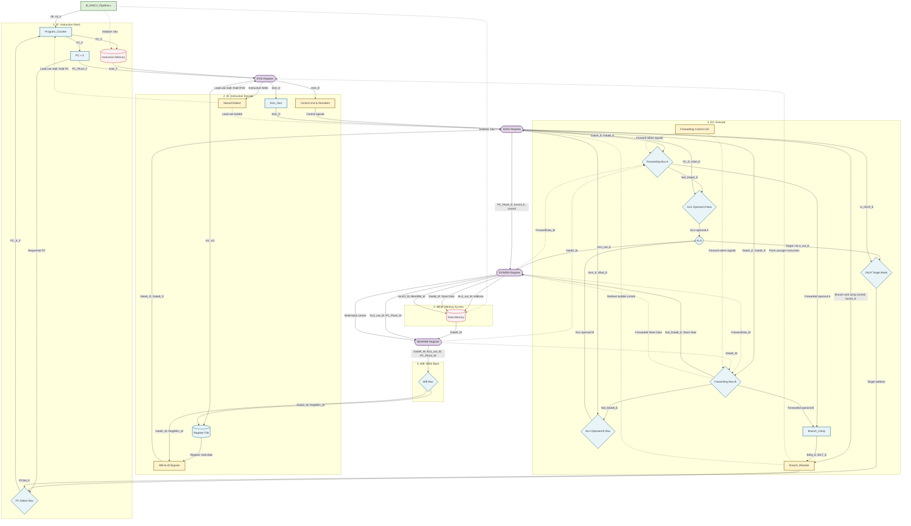

# RISC-V 5-Stage Pipelined (RV32I)

## Project Overview
This repository contains the RTL design and verification environment for a custom **32-bit RISC-V 5-Stage Pipelined Processor (RV32I)**. Evolved from a baseline Single-Cycle architecture, this core divides instruction execution into five distinct stages (`IF` $\rightarrow$ `ID` $\rightarrow$ `EX` $\rightarrow$ `MEM` $\rightarrow$ `WB`) separated by four pipeline registers. 

This project was developed to demonstrate practical experience in advanced computer architecture. It successfully handles read-after-write (RAW) data hazards dynamically via data forwarding (bypassing), resolves load-use hazards via pipeline stalling, optimizes control flow resolution in the Execute stage, and utilizes Cadence EDA tools for hardware verification.

## Key Features
- **RV32I Base Integer Instruction Set**: Supports R-Type, I-Type, Load/Store, Branch, and Jump instructions.
- **5-Stage Pipeline Execution**: Instruction Fetch (IF), Instruction Decode (ID), Execute (EX), Memory Access (MEM), and Write Back (WB). 
- **4 Inter-Stage Pipeline Registers**: Explicit synchronization registers (`IF/ID`, `ID/EX`, `EX/MEM`, `MEM/WB`) to isolate stage logic and prevent instruction data from being overwritten. *(Note: The WB stage is the final step and writes directly to architectural state, thus requiring no trailing register).*
- **Data Forwarding Unit**: Solves data hazards by bypassing stale Register File values with the most recent results from the `EX/MEM` or `MEM/WB` stages to the ALU, Branch Comparator, and Store Data path. The `EX/MEM` forwarding source is `ForwardData_M`, while the `MEM/WB` forwarding source is `DataD_W`.Comparator, and store-data path.
- **Hazard Detection & Stalling**: Intelligently monitors for Load-Use dependencies, stalling the PC and IF/ID stages while injecting a transparent bubble into the ID/EX stage—ensuring correctness without relying on software compiler-inserted `NOP`s.
- **Early Branch Resolution**: Branch and jump targets are calculated and resolved in the Execute (EX) stage, properly flushing younger, wrong-path instructions fetched into the IF and ID stages.

## Hardware Architecture

The system is partitioned into the 5-stage RISC-V datapath blocks and control units. Below is the block diagram of the pipelined processor core.



### Module Descriptions by Pipeline Stage:

1. **Stage 1: IF (Instruction Fetch)**
   - **`Program_Counter.v`**: Synchronous register holding the instruction address. Stalls during load-use hazards and redirects upon taken branches/jumps.
   - **`IMEM.v`**: Instruction Memory model.
   - **`IF_ID_reg.v`**: Pipeline register holding the fetched instruction and PC for the ID stage.

2. **Stage 2: ID (Instruction Decode)**
   - **`control_unit.v` (with `main_decoder` & `ALU_decoder`)**: Decodes the instruction to generate all datapath routing and memory signals.
   - **`RegisterFile.v`**: 32x32-bit memory array. Features an explicit **WB-to-ID write-through bypass** to resolve hazards when reading and writing the same register in the same clock cycle.
   - **`Imm_Gen.v`**: Generates sign-extended immediate values.
   - **`hazard_detect.v`**: Monitors dependencies between a Load in EX and operands in ID. Triggers a 1-cycle PC/IF_ID stall and an ID/EX bubble when a true load-use hazard is detected.
   - **`ID_EX_reg.v`**: Pipeline register passing data, immediates, and control signals to EX.

3. **Stage 3: EX (Execute)**
   - **`forward_unit.v`**: Dynamically detects data dependencies and selects the forwarding source for the EX-stage operands. It supports three data sources:
     - `DataA_E` / `DataB_E`: Original operand values from the ID/EX register.
     - `ForwardData_M`: Forwarding source from the EX/MEM stage, selecting `PC_Plus4_M` for JAL/JALR or `ALU_out_M` for other instructions.
     - `DataD_W`: Forwarding source from the MEM/WB stage, providing the final write-back value.

     The forwarded operands (`fwd_DataA_E` and `fwd_DataB_E`) are supplied to the ALU, Branch Comparator, and Store Data path. When both EX/MEM and MEM/WB contain a matching destination register, EX/MEM forwarding has priority because it contains the more recent result.
   - **`ALU.v`**: Performs arithmetic, logic, and address calculations.
   - **`Branch_Comp.v` & `Branch_Resolve.v`**: Evaluates condition flags and resolves branches/jumps. If taken, it issues a flush signal to younger instructions in the IF and ID stages.
   - **`EX_MEM_reg.v`**: Pipeline register carrying ALU results, store data, and control signals to MEM.

4. **Stage 4: MEM (Memory Access)**
   - **DMEM.v**: Data Memory model supporting load and store operations. The `funct3_M` signal is carried into the MEM stage to preserve the Single cycle memory access behavior.
   - **`MEM_WB_reg.v`**: The final pipeline register, holding memory read data and ALU results for the WB stage.

5. **Stage 5: WB (Write Back)**
   - **Write Back Logic**: A multiplexer selects between Data Memory output, ALU result, or PC+4 (for link instructions) to write back into the Register File. 

## Instruction Set Architecture (ISA) Support

| Type       | Instructions Supported | Description |
|------------|------------------------|-------------|
| **R-Type** | `add`, `sub`, `and`, `or`, `xor`, `sll`, `srl`, `sra`, `slt`, `sltu` | Register-to-register arithmetic and logic operations. |
| **I-Type** | `addi`, `slti`, `sltiu`, `xori`, `ori`,
`andi`, `slli`, `srli`, `srai`, `jalr` |
Register-immediate operations and indirect jump. |
| **S-Type** | `sb`, `sh`, `sw` | Store Byte, Halfword, and Word to Data Memory. |
| **B-Type** | `beq`, `bne`, `blt`, `bge`, `bltu`, `bgeu` | Conditional branches evaluating equality and magnitude. |
| **U-Type** | `lui`, `auipc` | Upper immediate instructions. |
| **J-Type** | `jal` | Jump and Link (unconditional jump with return address). |

## Verification Environment
The design is verified using a pure Verilog testbench (`tb_RISCV_Pipeline.v`). 
* **Self-Checking Assembly Program**: The core executes `test.S`, a custom assembly program rigorously designed to test data forwarding, load-use hazard stalls, branch flushing, and JALR mask behaviors without manually inserted NOPs.
* **Automated Checking**: The testbench continuously monitors the value of register `x7`. If all software tests pass, it writes `1` to `x7`; if it fails, it writes `-1` (`0xFFFFFFFF`). The testbench automatically halts, reports the status, and logs total execution cycles alongside stall cycles.

## Simulation & Synthesis (Cadence EDA Flow)

This project is built and verified using industry-standard Cadence EDA tools. A configured `Makefile` is provided to automate RTL simulation (Xcelium), logic synthesis (Genus).

### RTL Simulation (Cadence Xcelium)

**Compile RTL files:**
```bash
make compile
```

**Elaborate the testbench:**
```bash
make build
```

**Run RTL simulation:**
```bash
make run
```

**Run simulation and launch the waveform viewer (Cadence SimVision):**
```bash
make wave
```

### Logic Synthesis (Cadence Genus)

```bash
make syn
```

*Expected Simulation Output (from `make run`):*
```text
========================================
 [PASSED] ALL PIPELINE TESTS PASSED!
 - Data forwarding (ALU and Store)
 - Load-use hazard (Stall and Bubble)
 - JAL/JALR and Pipeline Flush
----------------------------------------
 REGRESSION REPORT:
 - Total Cycles: 19
 - Load-use Stall Cycles: 1
========================================
```